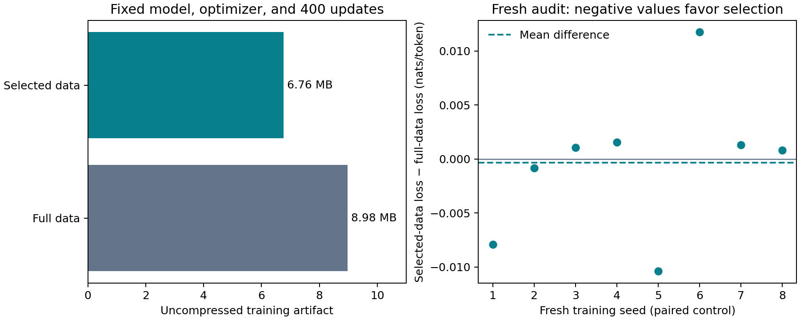
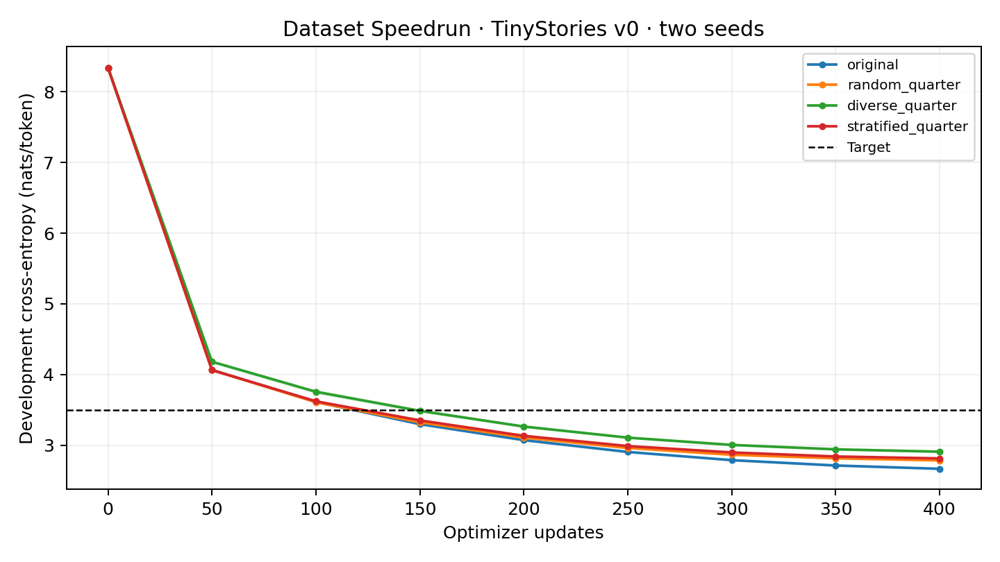

# Dataset Speedrun

**Same model. Same optimizer. 400 updates. How small can the training dataset get?**

This repository tests data selection and training-signal compression for language models.
The first track uses a small GPT trained from random initialization on TinyStories.
Muon updates hidden matrices. AdamW updates embeddings, the output head, and normalization parameters.

This is an independent benchmark inspired by [NanoGPT speedrun](https://github.com/KellerJordan/modded-nanogpt)
and [DataComp-LM](https://www.datacomp.ai/dclm/).
It is not a submission to the NanoGPT leaderboard. TinyStories loss values are not comparable to FineWeb loss values.

A new [FineWeb data track](research/fineweb/README.md) freezes the upstream modded-nanoGPT optimization baseline.
It compares FineWeb and FineWeb-Edu at 3,250 updates with the same 162.35M-parameter learner and canonical 3.28 validation target.
The first paired experiment is registered in [the frozen run plan](research/fineweb/plan.json). No FineWeb improvement is claimed yet.

## Enter the dataset compression challenge

Submit a smaller token array that matches the full-data model's held-out loss after 400 updates.
The main track fixes the architecture, tokenizer, loss, optimizer, batch size, and learning-rate schedule.
The reference artifact contains 4,490,269 tokens and occupies 8,980,666 bytes.
Smaller artifacts win only after paired quality checks across at least eight training seeds.

Read the [rules, submission format, and judging command](competition/README.md).
Use [the starter builder](competition/build.py) to create your first submission.
The [record registry](competition/leaderboard.json) credits verified results.

```bash
python -m competition.build --fraction 0.75 --output submissions/my-subset.json
python -m competition.judge --submission submissions/my-subset.json \
  --evaluation data/round2/audit.npy --output runs/my-subset-judge
```

Prepare the original training data and the round-two evaluation arrays first, as explained in the competition instructions.
The published audit is for reproduction. New records require an artifact frozen before a new audit cohort is assigned.
Teacher targets and gradient latents remain separate experimental tracks.
Storage savings and end-to-end compute savings are reported separately.

## First verified compression record

**8.98 MB → 6.76 MB, with matched held-out loss after 400 updates.**

| Entry | Training artifact | Mean fresh-audit loss | Confirmation |
|---|---:|---:|---|
| Full-data reference | 8,980,666 bytes | 2.974509 | 8 seeds |
| `influence75` | **6,761,798 bytes** | **2.974170** | 8 paired seeds |

Gradient-alignment selection retained 75% of training windows.
The resulting artifact is 24.7% smaller after accounting for explicit window boundaries.
The one-sided 95% upper bound on loss increase is 0.00415 nats, below the registered 0.01-nat limit.
This is a storage record at fixed training budget. It does not claim a training-time speedup.

[Method and evidence](research/round2/README.md) · [Artifact release](https://github.com/vishal1383/dataset-speedrun/releases/tag/compression-record-v1) · [Enter the challenge](competition/README.md)



The first target for contributors is to beat **6,761,798 bytes** under the same quality rule.

## First campaign: November 19, 2026

I completed an adaptive search over dataset subsets, sparse teacher targets, and low-rank gradient latents.
The campaign contains 44 search trials and 12 fresh-seed confirmations across two DGX Sparks.
The half-sized pool improved development loss but worsened fresh-audit loss: **3.0031 → 3.1014**.
No compressed candidate preserved fresh-audit quality.

Read the [autoresearch methods, results, and reproduction instructions](research/autoresearch/README.md).
The initial baseline results below remain unchanged.

## First track: `tinystories-v0`

| Setting | Fixed value |
|---|---|
| Model | 6,884,608 parameters; 6 decoder blocks, width 256, 4 attention heads |
| Tokenizer | Byte-level BPE, vocabulary 4,096, trained on the original training pool |
| Context | 256 tokens |
| Batch | 32 sequences; 8,192 target tokens per update |
| Budget | 400 updates; 3,276,800 target tokens |
| Optimizer | PyTorch Muon for hidden matrices; AdamW for other parameters |
| Precision | BF16 autocast; FP32 parameters and loss |
| Schedule | 20-update warmup; cosine decay to 10% of peak learning rate |
| Seeds | 17 and 42 |
| Development target | Cross-entropy ≤ 3.5 nats/token |
| Evaluation | Every 50 updates, including initialization and the final update |
| Development tokens | 32,768 target tokens |
| Audit test tokens | 131,072 target tokens, evaluated once per completed run |

The target and budget were fixed before the benchmark runs.
The ten-update smoke runs use a separate seed and are excluded from results.
The authoritative recipe is [the track configuration](configs/tinystories-v0.json).

## Initial experiments

All four recipes draw from the same 20,000 training documents.
Every run processes the same number of target tokens.
The smaller pools are sampled repeatedly; they do not receive fewer optimizer updates.

| Recipe | Documents | Stored tokens, including EOS | Selection rule |
|---|---:|---:|---|
| `original` | 20,000 | 4,490,269 | Full candidate pool |
| `random_quarter` | 5,000 | 1,120,397 | Uniform document subset |
| `diverse_quarter` | 5,000 | 1,523,493 | Highest distinct-token count divided by square root of token count |
| `stratified_quarter` | 5,000 | 1,122,700 | Random subset within ten document-length bins |

The diversity score still favors longer documents. This is a heuristic baseline, not a validated quality measure.
Quarter refers to document count. The recipes do not have equal storage sizes.

All eight runs completed on two DGX Sparks. Each Spark ran four experiments.

| Recipe | Final dev loss, mean ± sample SD | Audit test loss, mean ± sample SD | Target update, both seeds |
|---|---:|---:|---:|
| `original` | **2.6656 ± 0.0060** | **3.0192 ± 0.0047** | 150 |
| `random_quarter` | 2.7840 ± 0.0002 | 3.1702 ± 0.0080 | 150 |
| `diverse_quarter` | 2.9079 ± 0.0077 | 3.1735 ± 0.0122 | 150 |
| `stratified_quarter` | 2.8130 ± 0.0080 | 3.1742 ± 0.0095 | 150 |

**The full training pool wins at the fixed update budget. These subset recipes show no speedup at the registered target.**
The smaller pools reduce storage, but they increase final held-out loss.
Every run crosses the 3.5-nat target at update 150, within the 50-update evaluation resolution.
We retain this target rather than changing it after seeing the results.



Read the [experiment report](results/REPORT.md), [per-run table](results/summary.csv), and raw `result.json` files under [results](results/).
The sample standard deviation uses two seeds. It is not a confidence interval.

## Run it

The initial experiments use `nvcr.io/nvidia/pytorch:26.03-py3` on two NVIDIA GB10 GPUs.
Each run uses one GPU. The workers run independent experiments.
The image digest is `sha256:3c90e38f5ec51e51d1c73bd7eb3d83674a254f451147c5cadc4344314258a112`.

Start the container from this repository:

```bash
docker run --rm -it --gpus all --ipc=host \
  --user "$(id -u):$(id -g)" \
  -v "$PWD:/workspace" -w /workspace \
  --entrypoint bash nvcr.io/nvidia/pytorch:26.03-py3
```

Inside the container:

```bash
python prepare.py
python -m unittest discover -s tests -v
python train.py --recipe original --seed 17 --output runs/demo-original-seed17
```

For the full suite, use a fresh output directory. Published results remain under `results/`.
Run worker 0 on one GPU and worker 1 on the other GPU:

```bash
python run_suite.py --worker 0 --output-root runs/reproduction --log-dir logs/reproduction
python run_suite.py --worker 1 --output-root runs/reproduction --log-dir logs/reproduction
```

Use separate checkouts and caches on separate machines.
Copy the prepared `data/tinystories-v0/` directory to the second machine before launch.
Merge the eight result directories afterward, then run:

```bash
python report.py --results runs/reproduction
```

The launcher refuses to overwrite run directories. Inspect failed runs before choosing a new output directory.
Run names, worker status, and process logs are written under `logs/`.
Each public result includes the configuration, source hashes, initialization hash, data hashes, environment, and loss curve.

For an existing Python environment, install `requirements.txt`. Use a CUDA-enabled PyTorch build that supports your GPU.
The pinned container is the reference environment for the initial results.

## Data and evaluation protocol

The source is [TinyStories](https://huggingface.co/datasets/roneneldan/TinyStories), revision
`f54c09fd23315a6f9c86f9dc80f725de7d8f9c64`.
Preparation reads the first 20,000 documents of `TinyStories-train.txt`.
It reads the first 2,048 documents of `TinyStories-valid.txt` and splits these into disjoint development and audit sets.
The first 1,024 validation documents supply development data. The remaining 1,024 supply audit data.

Preparation removes normalized exact document duplicates within and across splits.
No duplicates were removed in the initial subset. Near-duplicate detection is not implemented.
The tokenizer and all selection scores use training documents only.
Evaluation text is used during preparation only for exact duplicate exclusion and encoding.
All recipes use the identical tokenizer and evaluation streams.

Documents are joined with EOS tokens. Fixed context windows can cross document boundaries.
Each evaluation target token is counted once. Context resets every 256 targets.
Training samples complete windows uniformly with replacement.
Each run uses an independent sampling generator with a fixed seed.

The published [artifact manifest](artifacts/tinystories-v0/manifest.json) records hashes, counts, source revision, and preparation cost.
The tokenizer and selected document indices are published. Raw source text and token arrays are downloaded or generated locally.
Data artifacts remain subject to the source dataset's [CDLA-Sharing-1.0 license](https://cdla.dev/sharing-1-0/).
The code uses the MIT license.

## What counts as a result

The following rules describe the historical `tinystories-v0` pilot.
New compression submissions use the [paired competition rules](competition/README.md).

The primary fixed-budget metric is final development cross-entropy.
The speedrun metric is the first scheduled development evaluation at or below the target.
A run that misses the target reports `not_reached`.
Threshold steps have 50-update resolution. The learning-rate schedule remains tied to the full 400-update budget.
Final audit loss checks whether the comparison transfers to disjoint documents.

Report both seeds. Two seeds provide an initial baseline, not a strong significance claim.
GPU timing is secondary. Include GPU type, software, train-loop time, setup time, and total experiment time.
Train-loop time includes batch gathering, forward/backward passes, clipping, optimizer steps, and synchronization.
It excludes evaluation, data preparation, and process startup.
Total experiment time includes setup and evaluation, but excludes data preparation and container startup.
Artifact construction cost must be reported separately, including teacher or search compute when used.

The first development and audit slices are public and small. They are not a hidden leaderboard judge.
After release, do not treat this audit split as an untouched test for methods developed against its published results.
Future competitive submissions need fresh audit data and additional seeds.

## Submission tracks

**Data-only:** change the materialized training token stream. Keep the model, tokenizer, loss, optimizer, and update schedule fixed.
Selection, repetition, and synthetic text are eligible. Declare source data, artifact size, and construction compute.
Do not optimize against audit text or audit loss.

**Gradient compression, experimental:** submit a bounded artifact that supplies gradients to the fixed optimizer.
The [autoresearch campaign](research/autoresearch/README.md) records artifact bytes, initialization dependence, construction cost, and online computation.
Full unrestricted gradients can encode trained weights. They do not establish learning efficiency by themselves.
The original baseline suite contains data-only experiments. The later gradient-replay experiments failed the quality target.

The [state-dependent gradient experiment](research/gradient_field/README.md) tested compressed targets that generate gradients from current student weights.
A 3.57 MB target reached 2.7617 fresh-audit loss in 200 updates, versus 2.9969 for full data after 400 updates.
The eight-seed pilot used approximately 6.0× less student training time, excluding teacher construction.
Directly loading the same compressed target achieved 2.3857 loss in approximately 11 ms.
The artifact encodes a trained checkpoint. This result remains outside the dataset-only leaderboard.

## Related work

- [NanoGPT speedrun](https://github.com/KellerJordan/modded-nanogpt): training-system speed under a loss target.
- [DataComp-LM](https://arxiv.org/abs/2406.11794): dataset curation with standardized training recipes.
- [Dataset Distillation by Matching Training Trajectories](https://arxiv.org/abs/2203.11932): optimize synthetic data through training trajectories.
- [Muon](https://github.com/KellerJordan/Muon): the optimizer that motivates the hidden-matrix update rule used here.

These references motivate the benchmark. They do not establish the results of this implementation.
