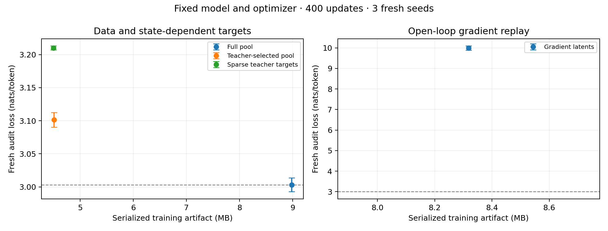

# Compression autoresearch

I implemented and ran a bounded adaptive search over training-data subsets, low-rank gradient trajectories, and sparse teacher targets.
The campaign used both DGX Sparks. It completed 44 search trials, 12 confirmation runs, and 3 source-model runs.
All six invariant tests passed.

**The first campaign found no compression method that preserved fresh-audit quality.**
A half-sized training pool improved development loss but regressed on a reserved audit slice.
Gradient replay failed even from its source initialization.

## Fresh-seed results

All confirmation runs used seeds 101, 202, and 303.
The model has 6,884,608 parameters. Each student receives exactly 400 optimizer updates.
The architecture and Muon/AdamW update rule remain fixed across methods.
Sparse teacher targets change the loss. Gradient replay replaces backward computation with decoded gradients.
These two methods are training-signal experiments, not entries in the data-only track.

| Training signal | Artifact MB | Mean development loss | Mean fresh-audit loss | Audit delta from full pool |
|---|---:|---:|---:|---:|
| Full token pool | 8.981 | 2.6738 | **3.0031** | — |
| Teacher-selected half | 4.508 | **2.6509** | 3.1014 | +0.0983 |
| Sparse teacher targets | 4.494 | 2.8313 | 3.2102 | +0.2070 |
| Low-rank gradient latents | 8.319 | 9.9698 | 9.9911 | +6.9879 |

The half-pool candidate regressed on the audit split for all three seeds.
Its paired audit deltas were +0.0971, +0.1029, and +0.0947 nats/token.
None of the compressed candidates passed the strict quality criterion or the secondary 0.02-nat tolerance.
The data and teacher-target candidates crossed the 3.5 development target at update 150, matching the full pool.
Gradient replay never crossed that target.



Error bars show sample standard deviation across three seeds. The two panels use different vertical scales.
Artifact sizes count serialized payloads, including metadata, without entropy compression.
The fixed tokenizer and common training code are excluded from every payload.
The baseline payload is the original uint16 token array. Selected windows store their boundary tokens explicitly.
The selected-half artifact is therefore 1.992× smaller, rather than exactly 2× smaller.

The three frozen payloads are available in the [autoresearch-v1 release](https://github.com/vishal1383/dataset-speedrun/releases/tag/autoresearch-v1).
[Release artifact hashes](results/release-artifacts.json) identify the exact files used for confirmation.
These artifacts derive from [TinyStories](https://huggingface.co/datasets/roneneldan/TinyStories), by Ronen Eldan and Yuanzhi Li.
Dataset-derived release files carry the source dataset's [CDLA-Sharing-1.0 license](https://cdla.dev/sharing-1-0/).

## What the search did

### Data-only search: 20 trials

A 400-update teacher scored all 17,540 candidate windows at updates 50 and 400.
The initial grid tested random, easy, learning-progress, median-difficulty, and difficulty-stratified selection.
Each method used one eighth, one quarter, or one half of the windows.
The search refined the best fraction and checked its three leading candidates on a second seed.

The lowest development loss used about 70.7% of the windows.
Before audit evaluation, promotion selected the smallest two-seed candidate that matched the full-pool development reference.
That candidate selected half the windows using the lowest final teacher loss.
The selection rule and its artifact hash were committed before confirmation.

### Gradient latents: 12 trials

A seed-17 reference run supplied clipped gradients at 28 update positions.
Each matrix gradient was represented by low-rank FP16 factors. Vector gradients remained dense FP16 tensors.
The decoder reconstructed adjacent gradient frames and interpolated between them.
The unchanged optimizers then applied the decoded gradients for 400 updates.

The initial search varied rank over 1, 2, and 4, and temporal subsampling over strides 1, 2, and 4.
An adaptive follow-up tested rank 8.
The best artifact below the original data-byte budget used rank 4 and all 28 frames.
It reached development loss 10.0551 from the same initialization used to construct it.
Its three fresh-initialization confirmations also failed.

This is open-loop replay. The artifact does not adapt its gradient direction to the current model state.
It contains no final checkpoint or external teacher used during replay.
Construction still requires a full reference training run and factorization work.

### State-dependent teacher targets: 12 trials

After replay failed, I tested targets that generate gradients from the current student state.
A separate teacher trained for 1,600 updates on the original pool.
The compressed artifact stores input tokens, two teacher token IDs per position, and two uint8 probabilities.
Unrecorded teacher probability mass is assigned to the original next-token target.

The search tested one sixteenth and one eighth of the windows, with four initial distillation weights.
It refined the strongest weight and checked two candidates on another seed.
The finalist used one eighth of the windows and distillation weight 0.875.
The added target payload reduced the overall storage saving to about 2×.
Its fresh-audit loss remained worse than the full pool.

This implementation is not an SDFT reproduction.
[SDFT](https://arxiv.org/abs/2601.19897) motivates state-dependent distillation, but its on-policy fine-tuning setup differs from this experiment.

## Why raw-gradient compression failed

I measured one diagnostic on the first update of seed 17, using the first transformer's QKV gradient.
Rank-8 factors produced **8.29% relative gradient error**, but **97.29% relative Muon-update error**.
Both errors use the Frobenius norm relative to the uncompressed reference.
The diagnostic isolates the gradient-driven update and excludes weight decay.
The other tested matrices and ranks are published in [the diagnostic record](results/muon-diagnostic.json).

My interpretation is that raw-gradient reconstruction is poorly matched to Muon's orthogonalization.
Muon can give substantial update weight to directions with small raw singular values.
Low-rank reconstruction can preserve most gradient energy while losing those update directions.
Sparse temporal sampling and divergence from the reference trajectory can also contribute to the training failure.
This single-step diagnostic does not isolate their respective effects on final loss.

## Audit and compute accounting

Search used only the original development slice and seeds 17 and 42.
The new audit stream uses source validation documents 2,048 through 4,095, excluding normalized exact duplicates.
It contains no documents from the original development or original audit subsets.
The tokenizer remains fixed. The new audit evaluates 131,072 target tokens.
Near-duplicate and template overlap remain possible.

The protocol was committed at `e64dbc6`.
Finalists and the audit manifest were frozen at `7561595`, before confirmation accessed audit loss.
The research engine reproduced the original seed-17 baseline within 0.00000006 nats on development loss.
Initialization hashes matched across all confirmation methods for each seed.

The 59 source, search, and confirmation runs consumed about 630 seconds of summed training-loop time across both GPUs.
Their recorded run durations summed to about 663 seconds.
Teacher scoring added about 10.1 seconds. [Target materialization costs](results/target-build-costs.json) are recorded separately.
These sums are not end-to-end campaign wall time or FLOP estimates.
They exclude source-code development, container startup, transfers, and some preparation work.
Three confirmation controls reused fresh-seed checkpoints trained while search was finishing. Each control is counted once.

The 400-update selection teacher cost about 13.3 training seconds.
The stronger teacher cost about 45.5 training seconds.
The gradient source cost about 11.7 training seconds plus 1.8 seconds of gradient capture and factorization.
Construction and search are additional costs. This campaign establishes no end-to-end training speedup.

The audit is now public. Future adaptive work needs another reserved slice or an independent judge.
Three seeds on one small synthetic-story corpus do not establish a general compression limit.

## Reproduce

Use the reference container and data preparation from the repository root README.
Start from a fresh checkout, so `runs/autoresearch-v1/` does not contain previous outputs.

```bash
python prepare.py
python research/autoresearch/prepare_audit.py
python -m unittest discover -s tests -v
```

On the first GPU:

```bash
python research/autoresearch/search.py data
python research/autoresearch/reserve_controls.py
python research/autoresearch/diagnose_muon.py
```

On the second GPU, in a separate checkout with the same prepared data:

```bash
python research/autoresearch/search.py gradients
python research/autoresearch/distill.py
```

Merge completed run artifacts under `runs/autoresearch-v1/` on the coordinator.
Keep each search's history, status, model-construction result, and payload files.
Freeze selection before confirmation:

```bash
python research/autoresearch/freeze.py
```

Copy the frozen manifest, selected payloads, reserved control checkpoints, and audit data to both checkouts.
Run `confirm.py --worker 0` on the first GPU and `confirm.py --worker 1` on the second GPU.
Then merge their `confirmation/` directories and generate the report:

```bash
python research/autoresearch/summarize.py
```

The scripts execute a bounded, adaptive parameter search. They do not claim to be an unattended agent that edits its own code.
The state-dependent-target follow-up was added after observing the replay failures.
All search trials, including failures, are retained in `results/*-history.json`.

## Next research decision

I would next optimize the compressed representation against the **optimizer update**, rather than raw-gradient energy.
A compact decoder should depend on model or optimizer state to correct trajectory drift.
For the data-only path, I would preserve difficulty and domain coverage while optimizing selection across multiple development slices.
The current single-slice improvement did not transfer to the reserved audit distribution.
These are proposed experiments; no follow-up process remains running after this campaign.

Related starting points include [trajectory-matching dataset distillation](https://arxiv.org/abs/2203.11932)
and [Muon](https://github.com/KellerJordan/Muon).
