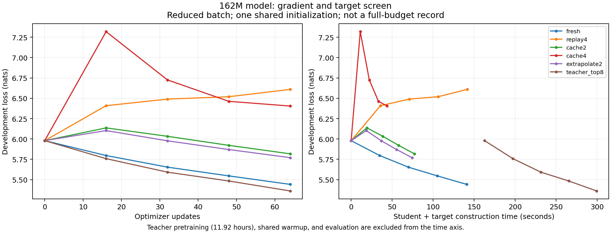

# Gradient refresh and teacher-target development screen

This screen tests whether richer or reused training signals improve progress per unit of student computation.
It uses the pinned 162M-parameter model and context length 1,024.
It is not a full-budget FineWeb result or a competition record.

## Completed results

Ten 64-update branches completed: six initial arms, two teacher confirmation branches, and two richer-gradient diagnostic branches.
All branches started from the same saved warmup state, whose development loss was 5.97940.

| Initial arm | Final development loss | Student time | Target construction time |
|---|---:|---:|---:|
| Fresh data | 5.44215 | 140.91 s | 0 |
| Replay each batch four times | 6.60876 | 141.58 s | 0 |
| Reuse gradient twice | 5.81754 | 77.13 s | Included in student time |
| Reuse gradient four times | 6.40444 | 43.84 s | Included in student time |
| Extrapolate between two-update refreshes | 5.77053 | 74.28 s | Included in student time |
| Full-context teacher targets | 5.36138 | 136.70 s | 162.75 s |

Fresh training reached lower loss at lower measured cost than each cached-gradient variant.
For example, fresh training reached 5.65389 in 69.80 seconds, while two-update reuse reached 5.81754 in 77.13 seconds.
The teacher improved fixed-update loss by 0.08078 nats.
The repeat on another training window reached 5.35190 with teacher targets versus 5.42893 with fresh hard targets, a 0.07703 improvement.
Both windows use the same model initialization. They do not establish transfer across initialization seeds.

Teacher construction plus student training took 299.45 and 313.56 seconds across the two windows.
The corresponding fresh controls took 140.91 and 140.73 seconds.
Teacher pretraining cost another 11.92 hours. It is not included in those construction times.
These results establish an early quality benefit, not an end-to-end speedup or a compression record.

The richer-gradient follow-up averaged four batches at every refresh, then reused that average for four updates.
It reached **6.06000**, compared with **5.43967** for its fresh-data control.
Both arms used 64 real backward batches and 64 optimizer updates, with identical source coverage.
The richer-gradient arm took 133.83 seconds; its control took 139.24 seconds.
The loss regression rejects this particular reuse prescription in the screened regime.
It does not rule out state-dependent gradient representations or trajectory distillation.

[Complete screen](results/signal-screen/summary.json) · [Cost analysis](results/signal-screen/analysis.json) ·
[Richer-gradient follow-up](results/signal-screen/oracle-summary.json) · [Setup history](results/signal-screen/setup-history.json)



## Gradient drift on fixed data

The diagnostic recomputed gradients on the same four real batches along a cached-gradient trajectory.
It compared cached and fresh update directions using the same current optimizer state.

| Sampled parameter matrix | Raw-gradient cosine after one update | Update cosine after one update | Update cosine after four updates |
|---|---:|---:|---:|
| First attention query | -0.342 | 0.924 | 0.620 |
| Middle MLP input | -0.054 | 0.932 | 0.704 |
| Last MLP output | 0.089 | 0.969 | 0.855 |
| Vocabulary head | 0.248 | 0.990 | 0.902 |

Optimizer history partly preserves direction despite rapid raw-gradient changes.
The update-direction mismatch still grows with reuse, especially in the first sampled attention matrix.
This is a local diagnostic at one early checkpoint. It does not establish behavior throughout training.
It also does not separate changing prediction residuals from changes in the model Jacobian.

The head's analytic AdamW direction matched the actual fused update within 0.00013% relative norm error.
The [diagnostic record](results/signal-screen/oracle-gradient-diagnostic.json) contains all measured values and its separate 32.28-second cost.

## Comparisons

| Arm | Signal supplied to the optimizer | Purpose |
|---|---|---|
| `fresh` | New real-data gradient at every update | Reference |
| `replay4` | Recompute gradients on the same batch for four updates | Isolate repeated-data effects |
| `cache2` | Reuse each raw gradient for two updates | Test short gradient reuse |
| `cache4` | Reuse each raw gradient for four updates | Test more aggressive reuse |
| `extrapolate2` | Refresh every two updates; extrapolate from the last two fresh gradients | Test a local gradient predictor |
| `teacher_top8` | New real text with cached full-context teacher targets | Test stronger supervision |

An additional `cache4_large` diagnostic averages gradients from four real batches at each four-update boundary.
It applies that average through the unchanged optimizer for four updates, then refreshes it.
Over 64 updates, it processes the same 64 real batches as `fresh` and performs the same number of backward passes.
This tests whether a richer gradient tolerates reuse. It does not provide cheap gradient construction or establish a speedup.
The follow-up restores the initial screen's saved warmup checkpoint and reruns the fresh-data control.

The cached-gradient arms use independent copies because the pinned Muon implementation modifies its gradient input.
The extrapolation formula is `g_last + 0.5 * (g_last - g_previous)` on the intervening update.
The first intervening update has no previous anchor and therefore uses the cached gradient.

The teacher is the completed original-data baseline checkpoint at step 3,250.
It predicts targets only for training text, without reading development or validation tokens during construction.
The target distribution assigns half of each stored top-eight probability to that token.
All remaining probability mass stays on the observed target. Missing teacher mass is not renormalized across the top eight.
This changes the training signal and imports knowledge from the teacher's full training run.

## Controls and limits

Every branch restores the same model, optimizer states, and RNG states after a shared 64-update warmup.
Initialization must match the original baseline's parameter hash.
The reset check verifies exact parameter and optimizer-state equality after an intervening training update.
The objective check compares zero-strength teacher supervision with upstream hard-token cross-entropy.
Selected gradient comparisons permit 0.5% relative Frobenius error because BF16 embedding reductions can vary with atomic order.
The record retains the measured errors, rather than only a pass flag.

Each update uses 64 sequences, accumulated through microbatches of 16 sequences.
This statistical batch is eight times smaller than the original benchmark batch.
The sum loss is multiplied by eight to preserve the original gradient magnitude convention.
This scaling does not reproduce the original batch's statistical information.
All arms use the original plateau learning rates and unchanged Muon and AdamW implementations.
The screen ends before the original learning-rate cooldown begins.

Each initial branch has 64 updates. Development evaluation uses the first 262,144 canonical validation tokens.
Those tokens are development data for this search and cannot serve as an untouched final judge.
The script conditionally repeats the best fixed-update improvement on another non-overlapping training window.
Selection requires at least 0.02 lower development loss than `fresh`.
This confirmation changes the data window, not the model initialization seed.
It does not establish late-training behavior or transfer across model seeds.

## Cost accounting

The records include student training time, gradient-refresh batches, microbatch backward calls, unique source tokens, and peak allocated memory.
Student time includes gradient copying and extrapolation. It excludes development evaluation and shared setup.
Teacher construction time includes checkpoint loading, target generation, and artifact serialization.
The teacher's previous training time is reported separately and must be added for an end-to-end claim.
Cached gradients are large artifacts; reduced backward computation does not imply reduced storage.

The analysis uses observed baseline checkpoints to bracket comparisons at equal cost.
It does not interpolate a learning curve into an asserted speedup.
Candidate confirmation by fixed-update loss is distinct from qualification by elapsed time.

## Collaboration and execution

Claude Opus 5.5 provided [candidate selection advice](results/signal-screen/claude-ideas.json) and a [code review](results/signal-screen/claude-review.json).
The local runner supplies the empirical evidence. Model-generated reviews are not experimental results.
The review's suggestion to retune learning rates or change AdamW state advancement was not applied.
Those changes would alter the optimizer comparison.
An additional Claude consultation reached the account usage limit. No further scientific review was received from that request.

The second Spark retains the user's protected inference service, which reserves approximately 100 GiB.
The screen uses the first Spark because the second has insufficient memory for this training configuration.
Two-host DDP remains the preferred execution mode when resources permit.

```bash
python -m torch.distributed.run --standalone --nproc_per_node=1 \
  research/fineweb/signal_screen.py --output runs/new-signal-screen \
  --warmup 64 --steps 64 --batch 64 --microbatch 16 --dev-tokens 262144
python research/fineweb/analyze_signal_screen.py runs/new-signal-screen/summary.json \
  --output runs/new-signal-screen/analysis.json
```

Use a new output directory for each run. Preserve source snapshots and failure records.
