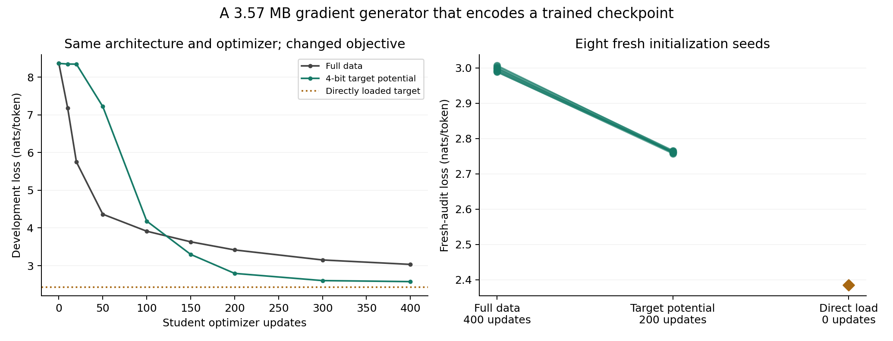

# Compressed representations that generate gradients

I tested whether a small representation can generate useful gradients from the student's current parameters.
The candidate reached lower held-out loss with half the updates and about 6.0× less student training time.
The representation encodes a trained checkpoint. Direct checkpoint loading is substantially faster and gives lower loss.
This experiment establishes an experimental baseline, not a new dataset-only record or a new distillation algorithm.

## Eight-seed result

The candidate was frozen in commit `05704f9` before evaluation on fresh audit documents.
The audit contains 524,288 target tokens from validation documents 8,192 through 12,287.
Seeds 1009–1016 were not used for candidate selection.

| Method | Artifact bytes | Student updates | Mean audit loss | Mean student training time |
|---|---:|---:|---:|---:|
| Original training data | 8,980,666 | 400 | 2.996852 | 13.8956 s |
| 4-bit target potential | 3,568,901 | 200 | 2.761729 | 2.3345 s |
| Directly loaded same target | 3,568,901 | 0 | 2.385663 | 0.01076 s median load/decode |

The direct-load row measures loading and decoding, not training. Its timing uses ten repetitions after model allocation.
Student training times exclude evaluation, process startup, and artifact decoding.
Candidate decoding added approximately 0.0109 seconds on average.
The 5.95× ratio compares mean training-loop times. Individual paired ratios ranged from 5.44× to 7.64×.

All eight candidate runs improved audit loss.
The mean paired difference was −0.235122 nats/token; the one-sided 95% upper bound was −0.231766.
This interval describes initialization uncertainty conditional on this audit text and the frozen artifact.
It does not measure uncertainty across source teachers, corpora, architectures, or hardware.



Read the [confirmation summary](results/confirmation-summary.json), [sixteen run records](results/confirmation-runs.json),
[frozen inputs](results/frozen.json), and [audit manifest](results/audit-manifest.json).
Download the exact artifact from the [experimental release](https://github.com/vishal1383/dataset-speedrun/releases/tag/gradient-field-v1).

## Representation and gradient

Let `z` contain a quantized teacher endpoint. The fixed decoder produces `D(z)`.
The student minimizes this analytic potential:

\[
L_z(\theta)=\frac12\sum_p\|\theta_p-D(z)_p\|_2^2,
\qquad \nabla_{\theta_p}L_z=\theta_p-D(z)_p.
\]

The representation responds to the current student parameters. It does not replay a fixed gradient sequence.
Autograd computes the potential gradients. The existing clipping, Muon, and AdamW code applies them.
The model architecture and optimizer hyperparameters remain unchanged.
The candidate stops at update 200 of the original 400-update learning-rate schedule.
The training objective changes from token cross-entropy to parameter distance.

The artifact stores signed 4-bit values with one FP16 scale per 128 parameters.
Two values occupy each byte. Shapes and metadata are included in the measured file size.
The student reads this artifact and the evaluation array. It does not read training tokens or the source teacher checkpoint.
The representation has no learned decoder beyond the encoded target parameters.
The potential itself was not optimized through a meta-learning objective.

The teacher used the original training pool, seed 271, and 1,600 optimizer updates.
Its recorded training-loop cost was 45.48 seconds on a GB10.
Teacher construction plus one candidate reconstruction therefore costs more than one 400-update baseline run.
This is a student-only speed result. It is not an end-to-end training speedup.

The direct-load control identifies the mechanism: the representation already contains a trained model.
Driving a student toward that model is slower than loading the decoded model.
New initialization seeds test reconstruction from different starting points; they do not create independently learned teacher solutions.
Under an unrestricted gradient-artifact rule, compressed checkpoints provide a strong and necessary baseline.

## Search and unsuccessful experiments

I completed 18 development runs before freezing the candidate.
The initial sweep used the existing 400-update teacher and seed 17.
It tested 4-bit, 8-bit, FP16, and rank-8/32/64 endpoint representations with quadratic and Huber potentials.
Rank decompositions compressed teacher displacement relative to its seed-271 initialization.

The 400-update teacher's 8-bit representation converged to approximately 3.0455 development loss.
The same-seed full-data control reached 3.0339. The representation missed the registered +0.01-nat tolerance.
Rank-8/32/64 potentials reached approximately 5.78, 5.14, and 4.81 loss, respectively.
Their decoded endpoints also had poor loss. These results do not establish failure of all low-rank representations.

I then tested 4-bit and 8-bit representations of the existing 1,600-update teacher.
The 4-bit quadratic potential first passed the development criterion at the measured 200-update checkpoint.
The 4-bit Huber potential first passed at update 300.
The frozen candidate uses the smaller 4-bit artifact and the earlier quadratic crossing.
No audit result was used to choose the artifact, potential, or update count.

The [initial history](results/development.json) and [strong-teacher history](results/strong/development.json) include every completed trial.
The [adaptive amendment](results/strong-amendment.json) explains the teacher change.
The [initial source snapshot](results/initial-experiment.py) matches the first sweep's recorded hashes.
A subsequent codec fix gives zero blocks a positive representable scale. It does not change those nonzero teacher blocks.

Development consumed 93.81 seconds of summed training time. Confirmation consumed another 129.84 seconds.
Both teacher construction costs and artifact encoding costs appear in [the compute record](results/compute.json).
Earlier research campaigns informed this experiment and have additional costs.

## Execution and scope

All completed trials in this campaign ran on `spark-a5a1`, using the reference NVIDIA PyTorch container.
The `spark-664c` SSH connection timed out. Tailscale was logged out.
The user then instructed me to use only the first Spark. I ran the second frozen confirmation cohort locally.
The planned seed-42 development sweep was not run. The initial sweep supplies one development seed; confirmation supplies eight fresh seeds.
The [execution record](results/execution.json) records this scheduling change.
Both local confirmation workers exited successfully. No experimental worker remains active.

The dataset-only leaderboard is unchanged. Its model, token loss, and eight-seed judging rules still apply.
This result changes the loss. It belongs to the experimental gradient track.
The fresh audit is now public and must not serve as an untouched test for future adaptive submissions.
Exact normalized duplicate exclusion was applied across training and prior evaluation documents. Near-duplicate exclusion was not applied.

## Reproduce

Use the reference container from the root README. Prepare the original data and the new audit:

```bash
python prepare.py
python research/round2/prepare.py
python research/gradient_field/prepare_audit.py
```

On the host, download `q4.pt` from the release into `runs/gradient-field-strong-v1/artifacts/`.
The recorded SHA-256 is `a9a7aca29e4dd4e244a41cc85de85f3a5df628301e824c59061bcf7c44a951c7`.
Run these commands inside the container:

```bash
python research/gradient_field/experiment.py run --seed 1009 --updates 200 \
  --artifact runs/gradient-field-strong-v1/artifacts/q4.pt \
  --evaluation data/gradient-field-v1/audit.npy --output runs/reproduction/field-1009
python research/gradient_field/experiment.py run --seed 1009 --updates 400 \
  --evaluation data/gradient-field-v1/audit.npy --output runs/reproduction/full-1009
```

Use the published artifact for exact reproduction. To rebuild the representation from training, first reconstruct the teacher:

```bash
PYTHONPATH=research/autoresearch python -c \
  'from distill import train; train("runs/autoresearch-v1/strong-teacher", seed=271, teacher=True)'
python research/gradient_field/build_strong.py
```

Use a fresh output directory for teacher reconstruction. Construction timing metadata can change the rebuilt artifact hash.

For a representation that remains training data, the relevant next experiment is synthetic-data trajectory matching.
That approach optimizes examples through student updates rather than encoding the teacher's endpoint directly.
[Matching Training Trajectories](https://arxiv.org/abs/2203.11932) provides a primary reference; this campaign did not reproduce that method.
