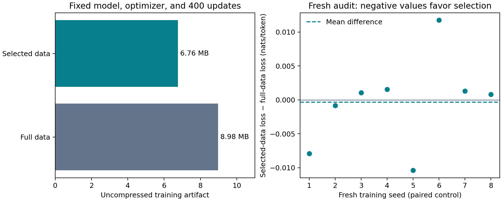

# Second compression campaign

I tested training-window selection with the original learner and exactly 400 updates.
The campaign completed 62 development runs before selecting one finalist.
The finalist stores 75% of the original training windows in a 6,761,798-byte artifact.
The full-data reference occupies 8,980,666 bytes.

## Confirmed record

The candidate passed the registered quality rule across eight new initialization seeds.

| Artifact | Bytes | Mean fresh-audit loss |
|---|---:|---:|
| Full data | 8,980,666 | 2.974509 |
| Gradient-alignment selection | 6,761,798 | 2.974170 |

The artifact is **24.7% smaller**, or **1.328× compressed**.
The mean paired loss difference is −0.000339 nats/token.
The one-sided 95% upper bound is +0.004146 nats, below the registered +0.01-nat limit.
The result supports matched quality under this rule. It does not establish lower population loss or exact equality.
Three seeds improved and five regressed. All eight pairs are included.



Read the [paired results](results/paired-results.csv), [judge summary](results/confirmation-summary.json), and [complete run records](results/confirmation-runs.json).
Download the exact artifact from the [record release](https://github.com/vishal1383/dataset-speedrun/releases/tag/compression-record-v1).
Both four-pair GPU workers completed with exit code zero.

## Method

The first campaign selected easy examples using a narrow development slice. That gain failed on fresh audit text.
This campaign used 1,024 windows sampled across the 4,096 previously exposed validation documents.
Those documents were treated as development data, including earlier audit documents.

I reused a training-only teacher with checkpoints at updates 50 and 400.
At each checkpoint, I computed the average gradient on the broader development set.
I then measured each training window's loss after positive and negative perturbations along that normalized gradient.
The symmetric finite difference estimates alignment between the training gradient and the development gradient.
I standardized scores at each checkpoint, averaged them, and retained the highest-scoring windows.

The selection teacher uses development gradients. The student sees only the resulting training token array.
The student model, optimizer, loss, batch size, and learning-rate schedule remain unchanged.
The selected windows come only from the original training pool.
This method is an influence-inspired selection heuristic. It does not compute exact influence functions or reproduce LESS.
[LESS](https://arxiv.org/abs/2402.04333) and [DsDm](https://arxiv.org/abs/2401.12926) are relevant precedents for model-aware data selection.

## Selection and audit separation

I tested random subsets, teacher difficulty, learnability, stratification, lexical coverage, and gradient alignment.
Search used seeds 17 and 42. All 62 completed runs appear in [the search history](results/search-history.json).
The selected 75% subset achieved development losses 3.026155 and 3.020503.
Matched full-data controls achieved 3.033862 and 3.029469.

The initial protocol preferred the smallest subset that matched the two-seed mean.
Before audit evaluation, I amended selection to require matching the control on both seeds.
The smaller 68.75% subset improved the mean but regressed on seed 42.
This amendment used development evidence only. It is recorded in [the protocol](protocol.json).

I froze the finalist and judge inputs in commit `38ebfc5` before running the confirmation cohort.
The audit uses 2,048 windows from new validation documents 4,096 through 8,191.
It contains 524,288 target tokens. Exact normalized document duplicates were excluded across splits and training.
Near-duplicate and story-template overlap remain possible.
Eight new initialization seeds receive paired full-data and selected-data training runs.
Each pair runs on the same GPU with identical initial parameters and source hashes.

The audit is now a public reproduction set. Future adaptive submissions require another reserved cohort.

## Reproduce the submitted artifact

Use the reference container and dependencies described in the root README.
From a fresh checkout:

```bash
python prepare.py
python research/round2/prepare.py
python research/round2/reproduce_artifact.py
python -m competition.judge --submission submissions/round2-influence75.json \
  --evaluation data/round2/audit.npy --output runs/reproduced-record
```

The published [window indices](results/selected-window-ids.json) reconstruct the exact artifact from the fixed training pool.
The builder checks its SHA-256 hash against the frozen submission manifest.
No teacher, source corpus, or selection scores are read by the student during candidate training.

To recompute the selection scores, reconstruct the seed-271 teacher checkpoints using the first campaign's fixed engine.
Run `research/round2/influence.py` with those checkpoints and the broader development array.
The selection code is in `research/round2/search.py`; the full experiment plans are adjacent JSON files.
Scoring initialization, precision, checkpoint hashes, and deterministic selection order affect exact ranking.
Use the published window indices for exact artifact reproduction.

## Costs and interpretation

The 62 development runs consumed 782.63 seconds of summed training-loop time across both Sparks.
Gradient-alignment scoring added 25.98 seconds. The reused 400-update teacher also has a construction cost.
The earlier 44 search trials informed this campaign and remain part of the research history.
Further construction and confirmation costs are reported separately in the result records.

Storage compression does not imply faster student training: every student still processes 3,276,800 target tokens.
The experiment concerns one 6.9M-parameter model and one TinyStories pool.
Confirmation uncertainty across seeds is conditional on this audit text. It does not establish transfer to other corpora or model scales.
The competition fixes an accessible experiment so that others can improve and test the result.
